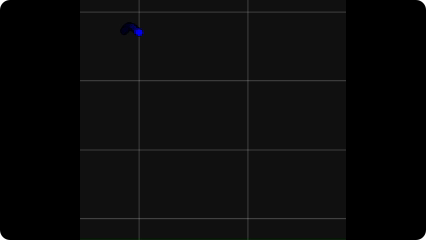
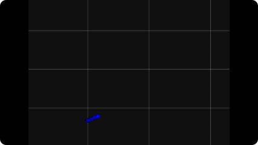
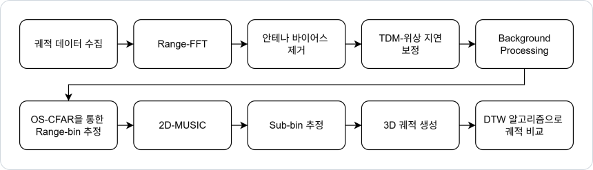

# In-Air Signature Verification System With FMCW RADAR

> **KICS 2025 추계학술대회 우수논문상 · 2025 핀테크 아이디어 공모전 우수상**

FMCW 레이더로 허공에 쓴 손 서명의 **3D 궤적**을 추출하고, DTW로 유사도를 비교해 본인확인을 수행하는 시스템입니다.

| L | A | B |
|:-:|:-:|:-:|
|  |  |  |

*레이더 앞에서 손으로 그린 글자의 3D 궤적 (전체 결과는 [2.9 3D 궤적 인식 및 검증](docs/09_3d_trajectory.md) 참고)*

## 목차

1. [프로젝트 설명](#1-프로젝트-설명)
2. [프로젝트 내용](#2-프로젝트-내용)
3. [프로젝트 결과](#3-프로젝트-결과)
4. [저장소 구조](#4-저장소-구조)
5. [실행 방법](#5-실행-방법)
6. [보고서](#6-보고서)
7. [Reference](#7-reference)

## 1. 프로젝트 설명

2024년 미 FBI 집계에 **[1]** 따르면 서명 위조로 부동산 등기 이전 후 주택을 담보대출 및 매도하여 사기범죄를 저지른 사례가 급증했다. 부동산 사기 9,359건에서 1.7억 달러의 피해를 입었으며 고령층의 피해가 44%를 차지한다.

또한 미 법무부 보도자료에 따르면, 가짜 공증 및 서명이 담긴 부동산 등기서를 제출해 주택 소유권을 탈취하여 약 85만 달러의 피해를 입힌 사기 범죄에서 배심원단이 위조 서명과 신분도용을 유죄로 인정한 사례도 있었다. 또, Caligrapher.ai와 같은 웹사이트에서조차 손글씨를 원하는 스타일에 맞게 서명을 생성할 수 있는 등 최근 AI의 발전에 따라 서명 위조가 쉬워지고 있다.

이와 같이 전통적 물리 서명은 보안문제에 있어 심각성을 가지고 있다. 따라서, 본 프로젝트에서는 FMCW 레이더를 이용해 손가락의 궤적을 3D로 인식하여 이를 전자서명으로써 활용하는 시스템을 개발함으로써 보안문제를 해결하고자 한다. 바코드에서 QR코드로 진화하며 수많은 정보를 담을 수 있게 됐듯이, 2D 서명에서 3D 서명으로 진화하며 더 많은 정보를 담아 정밀한 본인확인을 가능케 함은 물론 보안문제까지 해결한 차세대 서명 시스템을 개발했다.

기존 연구 **[2]** 에서는 SIMO 레이더를 이용하여 단순히 안테나 간 위상차이를 이용해 손가락의 각도를 추정하여 2D 궤적을 추출했다.

본 연구에서는 3개의 Tx, 4개의 Rx 안테나를 가지고 60GHz~64GHz의 주파수 대역대를 가진 FMCW 레이더인 TI사의 IWR-6843ISK-ODS 레이더를 사용했으며, 넓은 범위의 각도에서 궤적을 얻어야 하기에 수평, 수직각도가 넓은 ODS(OmniDirectional Sensor) 버전을 사용했다.

- TDM-MIMO(Time Division Multiplexing Multiple Input Multiple Output) 방식을 사용했으며 2D-MUSIC(2-Dimension MUltiple SIgnal Classification) 알고리즘을 통해 여러 물체의 수직, 수평 각도를 정밀하게 추정한다.
- OS-CFAR 알고리즘과 Doppler Interpolation을 통해 물체의 거리를 Sub-bin 수준으로 추정한다.
- 거리와 각도정보를 바탕으로 3D 좌표계에서 Frame 단위로 궤적을 나타낸다.
- 이렇게 얻어낸 궤적을 DTW(Dynamic Time Warping) 알고리즘을 통해 유사도를 비교한다.

이때, 같은 궤적이지만 사용자의 정지 시점이 다른 두 궤적에 대해서도 구분할 수 있기 때문에 사용자가 서명을 할 때의 미세한 습관조차 잡아낼 수 있다.

## 2. 프로젝트 내용



*프로젝트 FlowChart*

각 단계의 이론과 구현, 검증 과정은 아래 문서에 정리되어 있다.

| # | 문서 | 내용 |
|:-:|---|---|
| 2.1 | [Range FFT & OS-CFAR](docs/01_range_fft_os_cfar.md) | 비트 주파수와 거리의 관계, Range FFT, OS-CFAR 기반 거리 추정 |
| 2.2 | [2D MUSIC Algorithm](docs/02_2d_music.md) | Steering Vector, 가상 안테나 배열, 2D MUSIC 수식 유도 |
| 2.3 | [RADAR Parameter](docs/03_radar_parameter.md) | mmWaveStudio 설정, Chirp/Frame 파라미터, 거리 해상도 |
| 2.4 | [Doppler Interpolation](docs/04_doppler_interpolation.md) | Doppler 속도를 이용한 Sub-bin 거리 추정 |
| 2.5 | [TDM-MIMO Snapshot 생성](docs/05_tdm_mimo_snapshot.md) | Tx 간 Chirp 시간차에 의한 위상 보상 |
| 2.6 | [샘플 측정 방식](docs/06_sample_measurement.md) | 거리·각도·왕복 샘플 측정 및 검증 절차 |
| 2.7 | [Antenna Bias 보정](docs/07_antenna_bias_calibration.md) | 채널별 위상 바이어스(Steering mismatch) 보정 |
| 2.8 | [Background Processing](docs/08_background_processing.md) | 정적 clutter 제거 (LS 방식 vs 단순 차감) |
| 2.9 | [3D 궤적 인식 및 검증](docs/09_3d_trajectory.md) | 좌표 변환, 글자 궤적 결과, Tracking 검증 |
| 2.10 | [DTW를 이용한 유사도 비교](docs/10_dtw_similarity.md) | DTW 알고리즘, 궤적 간 유사도와 Warping Path |

## 3. 프로젝트 결과

해당 연구를 통해 사람의 손과 같은 작은 면적의 물체의 3D 좌표를 TDM-MIMO 방식을 통해 143Hz로 인식하였으며 사람이 손을 움직이는 행위를 통해 생성되는 복잡한 3D 궤적을 얻어 이의 유사도를 비교해 본인확인을 수행했다. 반사율이 금속에 비해 낮고 비교적 작은 신체부위의 궤적을 Sub-bin 수준의 거리와 2D-MUSIC 알고리즘을 통해 얻어낸 정확한 각도정보를 통해 20cm~100cm에서 3D 궤적을 정확히 얻어냈다. 이 궤적을 DTW 알고리즘으로 유사도를 구해 비교하여 본인확인을 할 수 있는 차세대 서명 방식을 구현했다는 것에 의의가 있다.

특히 그동안 많이 연구되지 않았던 방식인 Doppler 속도를 이용해 Sub-bin 단위에서 물체의 거리를 추정해냈으며, Eigenvalue를 내림차순으로 정렬한 2D-MUSIC 알고리즘의 각도추정이 MVDR, Bartlett과 같은 다른 방식보다 더 정밀한 각도추정을 해냈음을 실험적으로 증명했다.

MUSIC 알고리즘은 원래 여러 신호의 각도를 추정할 수 있는 알고리즘으로, 본 연구에서는 Rx 안테나가 4개라 3개까지 추정할 수 있다. 따라서 이를 이용해 RF 흡수소재를 통해 차폐된 공간에서 면적이 매우 작고 반사율이 낮은 손가락도 인식할 수 있는 가능성을 충분히 엿볼 수 있으며, 이를 통해 보안, 편의성을 모두 갖춘 차세대 서명방식 구현에 한 발짝 더 다가갈 수 있을 것이다.

또한, 6G 기술의 핵심에 해당하는 ISAC(Integrated Sensing and Communication)을 실제로 구현하는 데 있어, 다른 레이더의 위치를 정확하게 추정할 수 있는 기술적 기반을 마련했기에 향후 비슷한 모델의 두 레이더로 ISAC을 구현하는 데 큰 도움이 될 것이다.

## 4. 저장소 구조

```
.
├── README.md
├── src/                      # MATLAB 코드
│   ├── bgs.m                 # 배경 샘플에서 배경 추출 → bg.mat 생성
│   ├── ANT_Bias.m            # 안테나 채널별 위상 바이어스 추정 → ant_bias.mat 생성
│   ├── 3D_Trajectory.m       # Raw Data(.bin) → 3D 궤적(x, y, z) mat 파일 생성
│   └── DTW.m                 # 두 궤적 mat 파일의 DTW 유사도 비교 및 시각화
├── data/                     # 샘플 데이터
│   ├── ant_bias.mat          # 안테나 바이어스 보정값 (환경과 무관하게 고정 사용)
│   ├── A1.mat                # 'A' 궤적 샘플
│   ├── B1.mat                # 'B' 궤적 샘플 1
│   └── B2.mat                # 'B' 궤적 샘플 2
├── docs/                     # 단계별 상세 문서 (2.1 ~ 2.10)
│   └── images/               # 문서용 그림, 궤적 GIF
└── paper/                    # 논문 및 보고서 PDF
```

용량이 큰 파일(Raw Data `.bin`, 배경 `.mat` 등)은 저장소에 포함하지 않고 Google Drive로 공유한다.

- [Google Drive: 대용량 파일(.bin, .mat)](https://drive.google.com/drive/folders/1ClI24m2IQAHCyWpAhK5ZUT_JMJci-zVD?usp=sharing)

## 5. 실행 방법

전체 코드는 `ant_bias.mat`, `bg.mat`, 그리고 Raw Data `.bin` 파일이 필요하다. 스크립트들은 파일을 이름만으로 불러오므로, MATLAB에서 `src/`를 현재 폴더로 두고 데이터 폴더를 경로에 추가한 뒤 실행한다.

```matlab
cd src
addpath('../data');     % ant_bias.mat, 샘플 궤적
% Google Drive에서 받은 .bin 파일도 경로에 있는 폴더에 둔다
```

1. **배경 추출**: `bgs.m`으로 해당 측정 환경의 `bg.mat`을 생성한다. `ant_bias.mat`은 배경에 따라 달라지지 않아 고정으로 사용한다.
2. **3D 궤적 추출**: `3D_Trajectory.m`으로 Raw Data `.bin` 파일을 가공하면 Frame별 (x, y, z)가 담긴 `result.mat`이 생성된다.
3. **유사도 비교**: `DTW.m`에서 비교할 두 mat 파일(`fileA`, `fileB`)을 지정해 유사도를 구하고 본인확인을 진행한다. 포함된 샘플(`B1.mat`, `B2.mat`, `A1.mat`)로 바로 실행해 볼 수 있다.

각 스크립트 상단의 `filename` 변수에 사용할 `.bin` 파일 이름을 지정한다. 샘플 측정 시에는 반드시 정해진 위치, 각도에서 시작하여야 한다.

## 6. 보고서

- [KICS 2025 추계학술대회 논문](paper/KICS2025_3D_Signature_Paper.pdf)
- [In-Air Signature Verification System 보고서](paper/In-Air_Signature_Verification_System_Report.pdf)

## 7. Reference

[1] Carla Ayers, *"Deed Theft, Title Fraud"*, Kiplinger, 2025.6, <https://www.kiplinger.com/article/real-estate/t048-c050-s002-how-to-protect-your-home-from-deed-theft.html>

[2] G. Liu and X. Li, "The Method of Using Interferometry FMCW Radar for Air-Writing Digit Trajectory Tracking," in *Proc. 2023 3rd Int. Conf. Electron. Inf. Eng. Comput. Sci. (EIECS)*, Changchun, China, 2023, doi: 10.1109/EIECS59936.2023.10435391.

[3] F.-G. Yan, Z.-K. Chen, M.-J. Sun, Y. Shen, and M. Jin, "Two-dimensional direction-of-arrivals estimation based on one-dimensional search using rank deficiency principle," *International Journal of Antennas and Propagation*, vol. 2015, Article ID 127621, 2015. <https://doi.org/10.1155/2015/127621>

[4] <https://asp-eurasipjournals.springeropen.com/articles/10.1186/s13634-016-0419-y>
