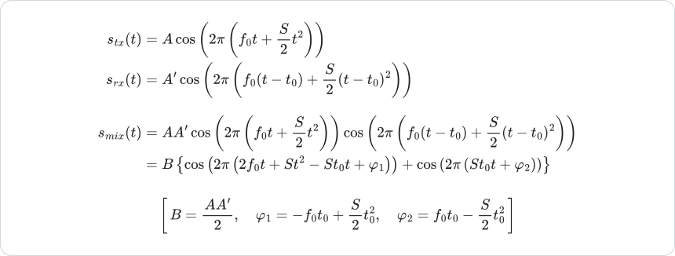
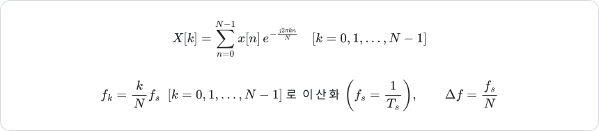

[← README](../README.md) · [다음](02_2d_music.md)

# 2.1 Range FFT & OS-CFAR

**A. FMCW 신호에서 비트 주파수와 거리의 관계**

FMCW(Frequency-Modulated Continuous Wave) 레이더는 선형적으로 주파수가 증가하는 신호를 송신하고 반사된 신호를 수신하는 센서이며 이를 통해 물체의 거리, 속도, 각도 정보를 측정할 수 있다. 수신된 신호는 처음에 송신한 신호에 대해서 시간 지연이 발생하게 되는데

FMCW 신호는 이러한 시간 지연으로 인해 주파수 차이가 생기게 된다. 주파수 차이는 송신 신호와 수신 신호를 mixer를 통해 혼합하면 높은 주파수 성분과 낮은 주파수 성분이 생기는데 이 중에서 낮은 주파수를 채택하면 구할 수 있다. 아래는 이에 대한 설명을 수학적으로 정리한 것이다.

*Tx & Rx signal mixing*

- $s_{tx}(t)$: Tx Signal
- $s_{rx}(t)$: Rx Signal
- $s_{mix}(t)$: Mixed Signal
- $A$: Magnitude of Tx Signal
- $A'$: Magnitude of Rx Signal
- $f_0$: Start Frequency
- $t_0$: Time Delay
- $S$: Frequency Sweep Slope

이렇게 믹서(mixer)를 통해 구한 주파수는 송신 신호와 수신 신호의 주파수의 차이와 같으며 이를 Beat Frequency라 부른다. FMCW 신호의 경우 구해진 비트 주파수는 위의 식에서 알 수 있다시피 지연된 시간과 주파수를 Sweep한 기울기의 곱으로 표현이 된다. 이 때 지연된 시간은 신호가 물체에 도달하고 반사되어 다시 수신단에 도달한 것이기 때문에 다음과 같은 관계식이 성립한다.

*Relationship between Range and Beat Frequency*

위의 관계식을 통해 실제 물체의 거리는 비트 주파수와 비례하는 관계를 가지고 있다는 것을 알 수 있다. 또한 비례관계에 있는 변수들은 모두 통제가 가능하거나 일정한 상수로 결국에는 비트 주파수를 구할 수 있다면 거리를 추정할 수 있다는 것을 의미하게 된다.

**B. Range FFT와 주파수의 관계**

FFT(Fast Fourier Transform)는 이산 푸리에 변환인 DFT(Discrete Fourier Transform)에서 중복되는 연산을 버터플라이 알고리즘으로 줄여 기존의 N^2의 시간 복잡도를 가지는 연산을 Nlog_2N 의 시간 복잡도로 줄인 푸리에 변환이다. 연산 과정에만 차이가 존재하지 FFT의 결과는 본질적으로 DFT와 같게 된다. DFT의 경우 기존의 이산 시간 신호를 연속적인 주파수 스펙트럼으로 변환한 DTFT(Discrete Time Fourier Transform)에서 주파수를 일정한 주파수 간격으로 이산화하여 샘플링한 것과 같다. DFT에서 중요한 것은 이산화된 신호가 원래 신호를 복원할 수 있는가이다. 이는 나이퀴스트 정리(Nyquist Theorem)에 의해 타겟으로 하는 신호의 주파수의 최소 2배 이상으로 샘플링이 필요하다. 그렇지 않으면 고주파 성분이 저주파 성분으로 왜곡되는 앨리어싱(Aliasing) 현상이 발생하게 된다. 이번 프로젝트에서 진행한 타겟은 60cm이내로 비트 주파수가 샘플링 주파수의 절반보다 작으므로 앨리어싱 문제에 대해서는 자유로운 편이다. 이 문제에 대해 2.3 레이더 Parameter에서 후술한다.

*DFT definition*

이론적으로 믹싱을 통해서 비트 주파수를 구하지만 우리가 사용한 제품에서는 비트 주파수로 처리된 IQ 데이터로 처리된 데이터가 출력된다. 이에 대해 FFT를 진행하게 되면 비트 주파수에 대한 주파수 스펙트럼이 나오게 되는데 이를 Range FFT라 부른다. 이론적으로 잡음이 없는 환경에 대해서는 비트 주파수에서 변환 값이 임펄스로 결과값이 나오겠지만 실제로는 잡음으로 인해 여러 주파수 스펙트럼이 포함되어 있을 것이다. 그럼에도 불구하고 비트 주파수에서 신호가 강한 것으로 여겨지는 것은 타당하므로 주파수 스펙트럼에서 power가 peak가 되는 주파수를 타겟에 대한 비트 주파수로 추정한다. 그리고 이렇게 구한 비트 주파수와 거리 관계식을 이용해 거리를 추정할 수 있다.

**C. OS-CFAR을 이용한 거리 추정 강화**

CFAR(Constant False Alarm Rate)는 거짓된 타겟이 경보될 확률을 일정하게 유지하는 알고리즘이며 일정하지 않은 잡음 환경에서 타겟을 식별할 확률을 높일 수 있다. 이 중에서 OS(Ordered Statistics)-CFAR을 도입하여 거리 추정 알고리즘을 보충하였다. 간단하게 알고리즘을 설명하면 다음과 같다.

1. 관심이 있는 셀(거리 bin)에 대해서 주변의 신호 값을 참고한다.
2. 이러한 신호들을 크기 순서대로 정렬한다.
3. 이 중에서 k번째 크기에 해당하는 신호를 잡음으로 간주한다.
4. k번째 값에 대해서 scale factor인 α를 곱해 threshold를 정해준다.
5. 관심 셀이 threshold를 넘으면 타겟 신호로 간주한다.

실제 OS-CFAR에서는 α에 대해서도 통계적인 기법으로 추정을 진행하나 이 알고리즘은 단순히 Range 추정에 도움이 되는 정도로만 사용되어 고정된 α=1.0의 값을 이용하였다.

---

[← README](../README.md) · [다음](02_2d_music.md)
