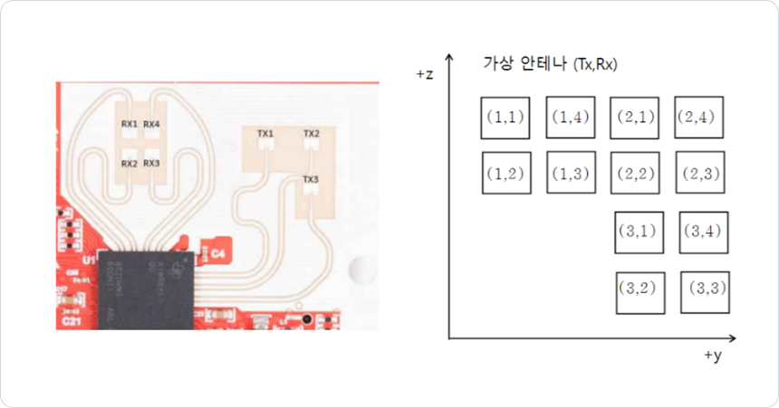
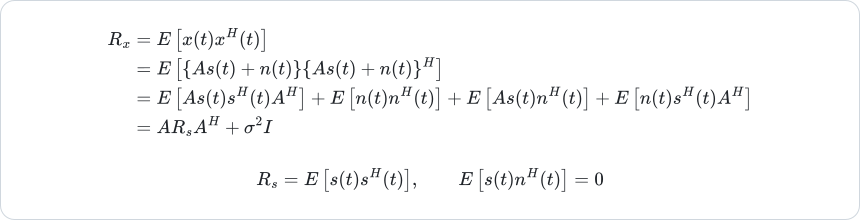
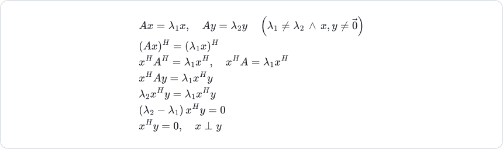
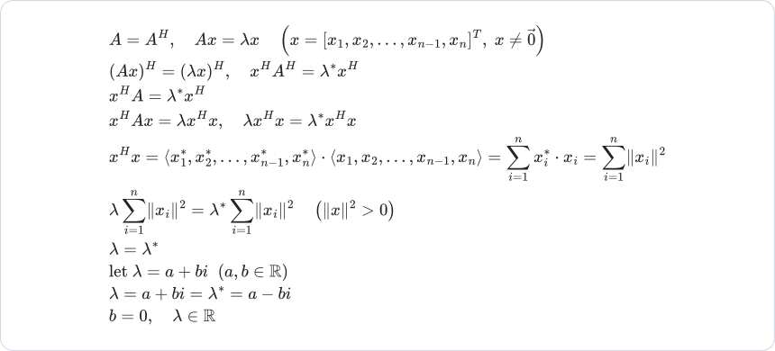
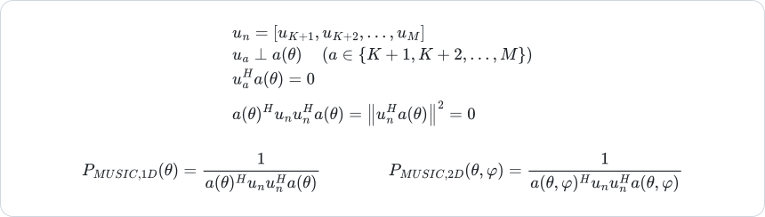

[← README](../README.md) · [이전](01_range_fft_os_cfar.md) · [다음](03_radar_parameter.md)

# 2.2 2D MUSIC Algorithm

**A. Steering Vector**

송신 신호가 수신단에 도달하는 시간은 수신 안테나의 물리적인 배열에 따라서 달라진다. 그리고 이러한 시간 지연은 수신 신호의 위상 차이를 야기한다. 이를 반영한 것이 Steering Vector이다. 우선은 수신 안테나가 동일한 간격을 가지는 직선형 배열인 ULA(Uniform Linear Array)를 기준으로 Steering Vector를 설명한다.

![ULA Antenna Array [4]](images/image_04.svg)

*ULA Antenna Array [4]*

*Relationship between Tx signal and Rx signal in ULAVector*

- $s(t)$: Tx Signal
- $x(t)$: Rx Signal
- $n(t)$: Noise Signal
- $a(\theta)$: Steering Vector
- $A$: Steering Matrix

기준이 되는 수신단은 센서1로 가정하였고 가장 위상이 많이 지연되었으므로 이에 대해서 Steering Vector의 복소지수함수는 음의 부호를 갖게 된다. 이를 1D Steering Vector이라 부른다. 안테나 배열이 1차원이 아니라 2차원이어도 적용이 가능한데 이를 2D Steering Vector라 부른다. 2D Steering Vector도 한 가지 불변성을 보일 수 있다면 쉽게 확장이 가능하다. 바로 직교하는 서로 다른 공간에 대해서 독립적이라는 성질이다. 예를 들어 x축방향으로 ULA로 배치된 안테나 배열을 가정하면 이 안테나 배열을 평행이동 하여도 Steering Vector에는 영향을 미치지 않는다. 위치벡터를 기반으로 하여 공간에 대한 불변적인 특성을 가지고 있기 때문이다. 이를 이용하면 2차원 안테나 배열에 대해서 수평방향과 수직방향의 1D Steering Vector를 독립적으로 적용하여 2D Steering Vector를 구성할 수 있다. 즉, 1D를 2번 적용하여 2D의 방향식을 세우는 것이다. 이번 프로젝트에서 선행적인 2D MUSIC을 참고하여 2D Steering Vector 식을 다음과 같이 세웠다.

*Proposed 2D Steering*

안테나 배열을 yz평면에 올려두었으며 수직각(Elevation)은 z축과 물체의 위치벡터가 이루는 각의 여각인 θ이며 수평각(Azimuth)은 위치벡터를 xy평면에 사영시킨 벡터와 y축과 이루는 각의 여각인 φ이다. 기본적으로 구좌표계와 동일하며 θ만 z축과 이루는 각의 여각인 점만 차이가 존재한다. 결국 2D Steering Vector는 1D를 2번 독립적으로 적용한 것이고 길이에 대해서는 구좌표계의 단위벡터 성분을 도입하여 나타내었다.

*IWR6843-ODS Antenna Array & Virtual Array*

위의 그림은 실제 사용한 제품의 안테나 배치와 이를 통해 생성한 가상 안테나 배열이다. Tx끼리는 λ의 거리 간격을 가지고 있으며 Rx끼리는 λ/2의 거리 간격을 가지고 있다. 이를 이용해 가상 안테나 배열을 생성하면 이웃한 안테나가 모두 λ/2의 거리 간격을 가지게 되는 것을 확인할 수 있다.

**B. 2D MUSIC Modeling**

우선 수신된 안테나 신호로부터 공분산 행렬을 생성해준다. 여기서 x(t)는 3Tx X 4Rx의 안테나를 사용하였으므로 채널의 수인 12에 맞춰 12X1의 열벡터이다. 또한 공분산의 정의상 x(t)의 평균은 0으로 처리될 필요가 있다. 그러나 실제로 x(t)의 평균은 0이라고 보장된 것은 아니기 때문에 이번 프로젝트에서는 평균을 0에 가깝게 만들 전처리 과정이 필요하였다. 전처리 부분은 이론적인 부분에서는 다루지 않고 후에 프로젝트에 진행한 보정 과정에서 후술한다. 이후 전개식은 x(t)가 정의된 식을 그대로 대입하였고 몇 가지 정의와 가정으로 간략화하였다. 이를 아래 수식과 함께 살펴본다.

먼저 가정 부분에서는 잡음인 n(t)는 송신 신호 s(t)와 Uncorrelated의 관계를 가져 이에 대한 기댓값은 0임을 가정하였다. 또한 n(t)는 가우시안 잡음으로 가정하여 잡음 자신에 대한 공분산 행렬의 값은 단위 행렬에 잡음의 분산이 스칼라배된 형태가 된다. 그리고 s(t)에 대한 공분산 행렬을 새롭게 정의하였다. 이 때 정의된 공분산 행렬은 모두 에르미트 행렬인데 에르미트 행렬의 유용한 특성이 존재하여 이에 대한 간단한 증명을 정리해두었다.

**성질 1. 서로 다른 고윳값의 고유벡터는 직교한다**

**성질 2. 고윳값은 모두 실수이다**

*Proof of characteristics of Hermitian Matrix*

먼저 첫번째 성질은 서로 다른 고윳값에 대해서 고유벡터가 직교하는 것이고 두번째 성질은 고윳값이 모두 실수로 구성된다는 점이다. 또한 첫번째 성질에서 언급되지 않은 서로 같은 고윳값에 대한 고유벡터는 그람-슈미트 직교화로 정규직교기저를 생성할 수 있기에 모든 고유벡터에 대한 성질로 확장할 수 있다. 이를 이용하면 에르미트 행렬은 직교대각화가 가능하다는 것을 보일 수 있다.

- $R_x$: $k \times k$ Matrix
- $B$: $k \times k$ Matrix
- $D$: $k \times k$ Matrix
- $P$: $k \times k$ Unitary Matrix
- $A$: $M \times k$ Matrix

*Spatial Analysis of Covariance Maxtrix of Rx signal*

이를 통해 x에 대한 공분산 행렬을 다음과 같이 정의할 수 있다. 또한 직교대각화와 SVD를 이용하여 대각행렬 D는 PSD의 성질을 가져 양의 대각행렬로 나타낼 수 있다는 것도 확인할 수 있다. 이를 통해 B를 정의하게 되는데 $D^{1\over 2}$과 P는 행렬식이 0이 아니므로 공간이 축소되는 선형변환이 아니다. 따라서 행렬 A와 B가 생성하는 공간은 서로 같게 된다.

*Analysis of Eigen Vector of Covariance Matrix*

다음은 공분산 행렬의 고유벡터이다. 대각행렬 D에 대해 직교대각화하고 고윳값의 배치는 크기가 큰 순서대로 배치하였다. 그리고 이에 대응하여 고윳값이 큰 값에 대응되는 고유벡터는 신호가 생성하는 sub-space로 가정하고 반대로 작은 값은 잡음이 생성하는 sub-space로 가정한다. 이 때 신호에 대한 sub-space는 고유벡터 u가 생성하는 공간의 부분공간이 된다. 고유벡터 u가 생성하는 공간은 u가 {BB}^H의 고유벡터와 같으므로 {BB}^H가 생성하는 공간에 속하게 된다. 또한 {BB}^H는 B가 생성하는 공간의 부분공간이고 이는 A의 공간과 같으므로 결론적으로 신호에 대한 Sub-space는 A의 부분공간이 된다. 이 때 가정에서 A는 K개의 신호를 가지고, u 역시 K개의 도래 신호를 가정하므로 둘의 차원인 rank(A)=rank(u_s)가 되어 A가 생성하는 공간이 결국 신호에 대한 Sub-space의 공간과 같음을 알 수 있다.

*Derived P_MUSIC Fomula*

결론적으로 A는 잡음의 sub-space와 직교하게 되며 이를 이용해서 잡음 공간의 고유벡터와 A의 Steering Vector가 서로 수직임을 알 수 있다. 그 결과를 이용해 P_MUSIC에 대한 식을 쓰면 위와 같다. 이론적으로 내적이 0이지만 실제로는 0이 되지 않을 가능성이 높고 0에 가까운 것보다는 무한대에 가깝게 peak를 찍는 것이 더 시각화적인 측면에서 유리하기 때문에 P에 대한 식은 역수로 표현이 되었다. Θ에 대해서 P값이 최대가 되는 각이 도래각으로 추정할 수 있으며 2D에 대해서도 동일한 전개식으로 적용할 수 있다.

---

[← README](../README.md) · [이전](01_range_fft_os_cfar.md) · [다음](03_radar_parameter.md)
