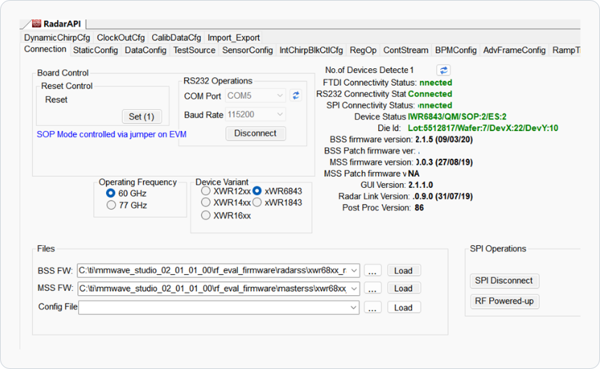
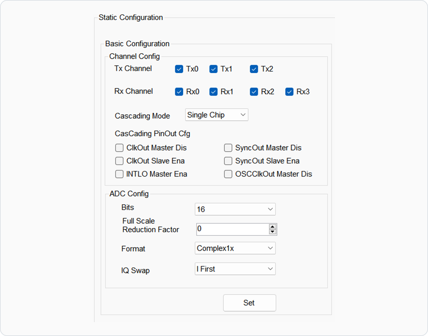
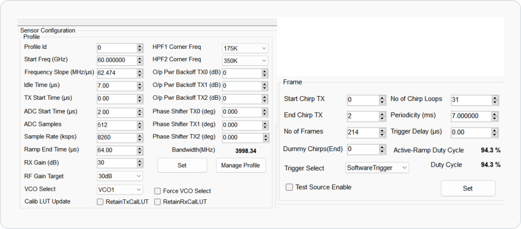

[← README](../README.md) · [이전](02_2d_music.md) · [다음](04_doppler_interpolation.md)

# 2.3 RADAR Parameter

mmWaveStudio(TI 제공 SDK)를 통해 Raw Data를 수집했으며 다음의 과정을 거쳐 진행했다.

*Connection Tab*

*Static Configuration Using Complex 1x Mode(I I Q Q 순으로 데이터를 받음을 의미)*

*Sensor Configuration Tab(RADAR Parameter)*

본 연구에서는 각도의 정밀한 추정, Measurement Rate 상승을 위해 TDM-MIMO(Time Division Multiplexing Multiple Input Multiple Output)방식을 사용했다. 하나의 Frame안에서 Doppler 속도와 FFT의 안정화를 위해 31번의 loop를 적용하였으며 하나의 loop안에는 3개의 Tx를 번갈아가며 사용하여 3개의 Chirp이 존재한다. 각각의 Chirp은 하드웨어의 최대치에 가까운 3998.43 MHz(약 4GHz)를 sweep하며 작동한다. Measurement Rate가 143Hz이며 300 Frame의 경우 2.1초동안 샘플을 측정하며 한 Frame안에는 31개의 loop, 93개의 Chirp이 들어있다.

Figure 15에서 알 수 있듯 Frequency Slope은 62.498 MHz/μs, Idle Time 7 μs, Ramp End Time 64 μs, Frame Periodicity 7ms로 설정하여 94.3%의 Duty Cycle을 얻었으며 장시간 사용엔 발열 문제로 부적합하나, 단기간 샘플 수집용으로는 적절하면서 최고 수준의 Measurement Rate를 뽑아낼 수 있도록 설정하였다. 또한 ADC samples를 512, Sample Rate를 8260 ksps로 설정하여 최고 수준의 유효거리 해상도인 3.869cm를 유지한 상태에서 Measurement Rate를 최고수준으로 하였다. 이론적 거리 해상도와 유효 거리 해상도는 조금 다른데 그 식은 다음과 같다.

이론적 거리 해상도:

유효 거리 해상도(Range bin 간격):

유효 거리 해상도 식에 따르면, Range bin이 3.869cm(약 3.87cm)가 나온다. 즉, 물체의 거리에 대해 Range FFT만 적용할 경우 3.87cm로 양자화된 값만 얻을 수 있다. 이 격자 사이의 값을 얻기 위해선 Sub-bin단위의 추정이 필요하다. 이는 2.4 Doppler Interpolation에서 이어진다.

---

[← README](../README.md) · [이전](02_2d_music.md) · [다음](04_doppler_interpolation.md)
