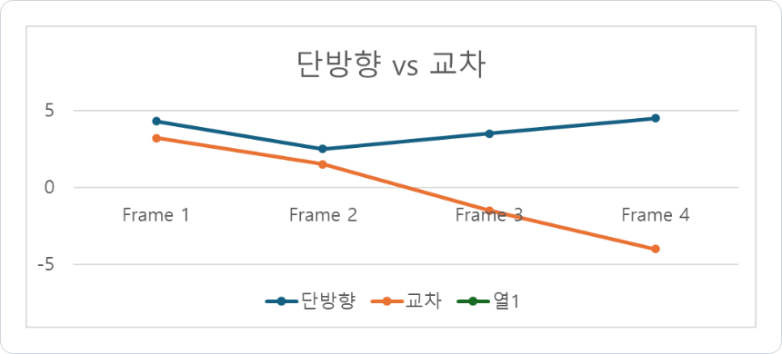

[← README](../README.md) · [이전](03_radar_parameter.md) · [다음](05_tdm_mimo_snapshot.md)

# 2.4 Doppler Interpolation

Range FFT를 통해 물체의 거리를 추정할 때 Range bin인 3.87cm로 양자화되는 문제가 있었다. 이에 물체의 거리를 Sub-bin단위에서 추정하여 궤적을 더 정밀하게 얻어내기 위해 Frame별 Doppler 속도를 이용한 방법을 직접 고안했다. 먼저, Frame을 같은 Range bin에 속한 Frame들끼리 구분한다. 이때 교차(Intersection)가 일어나는 Range bin과 단방향 Range bin을 구분한다. 이를 구분하기 위해 Frame별 Doppler 속도를 Frame별로 plot 했을 때 다음과 같이 구분할 수 있을 것이다.

*단방향 vs 교차 Range bin 비교*

단방향 Range bin은 변위와 이동거리의 부호가 같지만, 교차 Range bin은 변위와 이동거리의 부호가 항상 같지 않으며, MATLAB코드에서는 변위를 이동거리로 나눈 값이 0.35 이하면 교차 Range bin으로 구분했다.

이렇게 구분된 Range bin에 대해 먼저 공통적으로 $\alpha$를 도입했다. $\alpha$는 (3.87cm / 변위)로, 각 Frame별 Doppler 속도 × 0.007s(Frame Periodicity) × $\alpha$만큼 움직였다고 추정한다. 즉 $\alpha$를 통해 한 Range bin안의 Frame들의 변위의 합을 Range bin인 3.87cm에 맞게 normalize한 것이다. 만약 MATLAB코드 기준 Frame별로 loop를 돌리다가, Range bin이 달라지면 init_pos(Initial Positon)로 달라진 Range bin에 맞게 초기위치를 잡는다. 이렇게 Doppler 속도를 이용하여 Range bin별로 Frame별 위치를 추정할 수 있어 Doppler Interpolation이라고 부르게 되었다.

교차 Range bin에서만 $\beta$를 도입했다. 그 이유는 다음 그림을 통해 알 수 있다.

*$\beta$ 값에 따른 Range bin안에서 궤적 차이(왼쪽부터 $\beta$ = 0.3, $\beta$ = 0.9)*

교차 Range bin에서는 $\alpha$ 만 곱하게 되면 모든 반환점이 Range bin 끝에 위치하게 되는 오류를 범할 수 있다. 따라서 반환점의 위치를 특정하는 $\beta$를 곱하여 그 위치를 추정했다. $\beta$의 범위는 0~1이며, 클수록 반환점이 초기위치(Init_pos)로부터 멀다. $\beta$는 해당 Range bin에서의 이동거리를 다른 Range bin의 이동거리의 최소부터 최대까지 범위 안에서 normalize하여 구했다.

---

[← README](../README.md) · [이전](03_radar_parameter.md) · [다음](05_tdm_mimo_snapshot.md)
