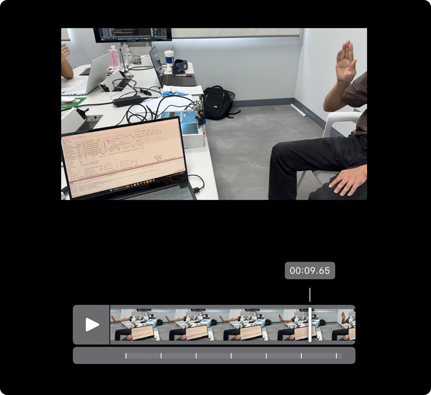

[← README](../README.md) · [이전](05_tdm_mimo_snapshot.md) · [다음](07_antenna_bias_calibration.md)

# 2.6 샘플 측정 방식

*거리 및 각도별 샘플 측정 과정*

레이더로부터 떨어진 거리에 따라 물체를 얼마나 정확히 인식하는지를 확인하기 위해, 레이더 4Rx의 중점을 기준으로 수평각과 수직각을 모두 0도로 설정한 상태에서 다양한 거리별 정지 샘플을 생성하였다. Range bin의 해상도가 3.87 cm이므로, 3.87 cm 간격으로 물체를 인식할 수 있으며 이에 따라 4, 8, 12, 16, 20, 24, 28 cm 위치에 샘플을 배치하였다. 실험 대상은 노트북 표면을 사용하였는데, 이는 원래 손을 대상으로 측정하고자 했으나 피부는 금속보다 반사율이 낮고 표면도 매끄럽지 않아 초기 검증에서는 탐지가 용이한 노트북을 사용하였다. Range FFT를 통해 peak가 가장 크게 나타나는 지점을 확인하고, 해당 Range bin의 값이 실제 물체가 위치한 거리와 일치하는지를 비교하였다. 그 결과, 모든 샘플에서 일관되게 실제보다 약 9 cm 더 멀리 있는 것으로 인식됨을 확인하였고, 이후 코드 수정을 통해 이 오차 문제를 해결할 수 있었다.

이어 물체를 손바닥으로 교체하여 동일한 실험을 진행한 결과, 노트북과 같은 결과가 나타나 손 역시 인식됨을 확인하였다. 이후에는 수평각과 수직각을 모두 0도로 유지한 상태에서, 정지 상태가 아닌 물체가 레이더로부터 점점 멀어지거나 가까워지는 샘플을 제작하여 검증을 진행하였다. 그 결과 Range FFT에서 검출되는 peak가 실제 물체의 움직임에 따라 이동하는 것을 확인할 수 있었다. 이때 레이더의 측정 프레임 수는 300개였으며, 프레임 간격이 0.007 s이므로 총 2.1 초 길이의 샘플을 이용하였다.

다음으로 수평각도와 수직각도를 측정하기 위해 2D-MUSIC 알고리즘을 적용하였다. Range FFT를 통해 물체가 존재하는 Range bin을 선택한 뒤 해당 bin에 대해 2D-MUSIC을 수행하였다. 그러나 잘못된 Range bin을 선택하면 원하는 추정 결과가 나오지 않는 문제가 발생하였으며, 이는 레이더가 바라보는 방향에 존재하는 다른 물체나 사람의 영향으로 판단되었다. 따라서 Range bin을 6번(19.35 cm ~ 23.22 cm)으로 고정하고, 20 cm 지점에 샘플을 배치하여 각도를 측정하였다. IWR6843ISK-ODS는 수평과 수직 모두 ±60°의 시야각(FOV, -3 dB 기준)을 가지므로, 정지된 물체의 수평각을 -60°, 0°, 60°, 수직각을 -60°, 0°, 60°로 설정하여 총 9개의 샘플을 제작하고 각도 추정을 검증하였다.

마지막 단계에서는 Range bin 내에서 Sub-bin 수준의 거리 추정을 검증하기 위해 왕복 이동 샘플을 수집하였다. 특히 방향이 전환되는 시점을 얼마나 정확히 추정하는지를 확인하기 위해, 측정을 시작한 시점부터 방향이 바뀌는 시점까지의 시간을 측정하였다. 이를 위해 샘플 측정과 동시에 스마트폰의 슬로 모션 모드로 영상을 촬영하여 실제 시간 간격을 기록하였으며, 약 0.01 초의 허용 오차 범위를 두고 비교하였다. 그 결과 MATLAB 코드에서 계산된 시간 간격과 영상 측정값 간의 차이는 최대 0.01 초 수준이었으며, 이를 통해 Sub-bin 수준의 거리 추정이 가능함을 검증할 수 있었다.

*왕복 시점을 측정하기 위한 방법, 카메라 동시 촬영*

---

[← README](../README.md) · [이전](05_tdm_mimo_snapshot.md) · [다음](07_antenna_bias_calibration.md)
