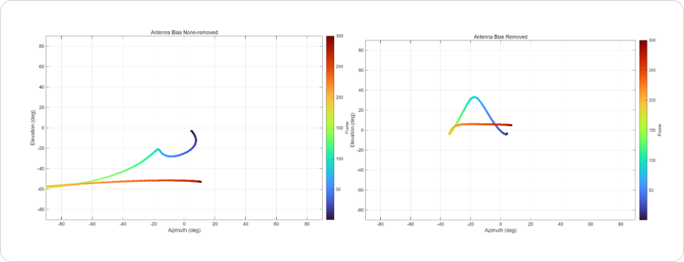

[← README](../README.md) · [이전](06_sample_measurement.md) · [다음](08_background_processing.md)

# 2.7 Antenna Bias 보정(Steering mismatch 보정)

현실의 안테나에선 배선 길이 · Clock Skew · 경로차로 인해 안테나 채널별 복소 이득 $g_m=a_me^{j\phi_m}$ 이 생기며, 이는 Steering mismatch를 유발한다. 이 불일치는 Main robe 확장, Side robe 상승, MUSIC 불안정성으로 이어진다. 이러한 바이어스를 보정하기 위해 안테나 1Tx, 1Rx 대비 채널별 위상 차이 $(b_m)$에 켤레 값을 취하여 원 신호 값에 곱함으로써 위상 값을 정렬하였다.

보정 후 2D-MUSIC의 azimuth 및 elevation 궤적은 실제로 사람이 그린 'A' 형태의 방향성과 일치하였다.
(아래 그림 참조)

*Antenna Bias 보정 전/후 비교(좌: 보정 전, 우: 보정 후)*

---

[← README](../README.md) · [이전](06_sample_measurement.md) · [다음](08_background_processing.md)
