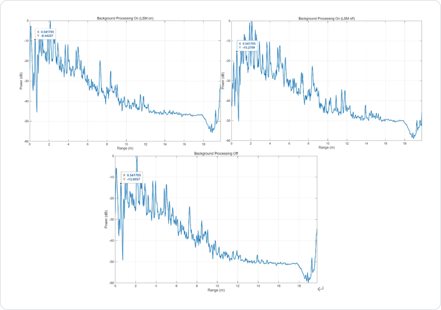

[← README](../README.md) · [이전](07_antenna_bias_calibration.md) · [다음](09_3d_trajectory.md)

# 2.8 Background Processing

FMCW 레이더 환경에서는 벽, 바닥, 장비와 같은 정적 반사체(clutter)로 인해 Range FFT 결과에 항상 강한 배경 성분이 포함된다. 이 배경 성분은 타깃 신호보다 수십 dB 이상 크게 나타날 수 있으며, 이로 인해 작은 타깃은 피크 탐지나 CFAR 알고리즘을 적용하기 전에 이미 묻혀버릴 수 있다. 따라서 배경을 먼저 제거해 주는 과정은 관심 Range bin에서 타깃 성분의 피크 대비(PSR, SNR)를 높이고, 이후의 탐지 및 추적 단계가 안정적으로 동작할 수 있도록 하는 데 필수적이다.
본 연구에서는 타깃이 0.54 m에 위치한 마지막 프레임의 Range FFT 결과를 기준으로, 관심 Range bin 내에서 배경 제거 전후의 피크 대비를 비교하였다. 이를 통해 배경처리가 실제 탐지 성능에 미치는 영향을 확인하고자 한다. 배경처리 방법으로는 최소 자승법으로 배경이 원 신호에서 차지하는 비율만큼의 가중치를 빼는 방법, 일반적인 뺄셈으로 단순 차감을 하는 방법, 두가지를 비교해 보았다.

- 단순 차감:

- 최소자승(LS) 스케일 보정:

*배경처리 전/후 및 방법에 따른 차이 비교 (좌 상단: LS 방식의 배경처리 적용 Range FFT그래프, 우 상단: 단순 차감 방식의 배경처리 적용 Range FFT 그래프, 하단: 배경처리 적용 전의 Range FFT 그래프)*

본 데이터셋에서는 단순 차감 방법이 LS 보정보다 관심 Range bin에서 더 뚜렷한 피크 대비를 제공하였다. 이는 배경이 안정적이고 타깃 성분과의 상관이 낮을 때 단순 차감이 불필요한 타깃 소거를 최소화하기 때문이다. 이와 같은 Background Processing은 bgs.m을 통해 구현했다.

---

[← README](../README.md) · [이전](07_antenna_bias_calibration.md) · [다음](09_3d_trajectory.md)
