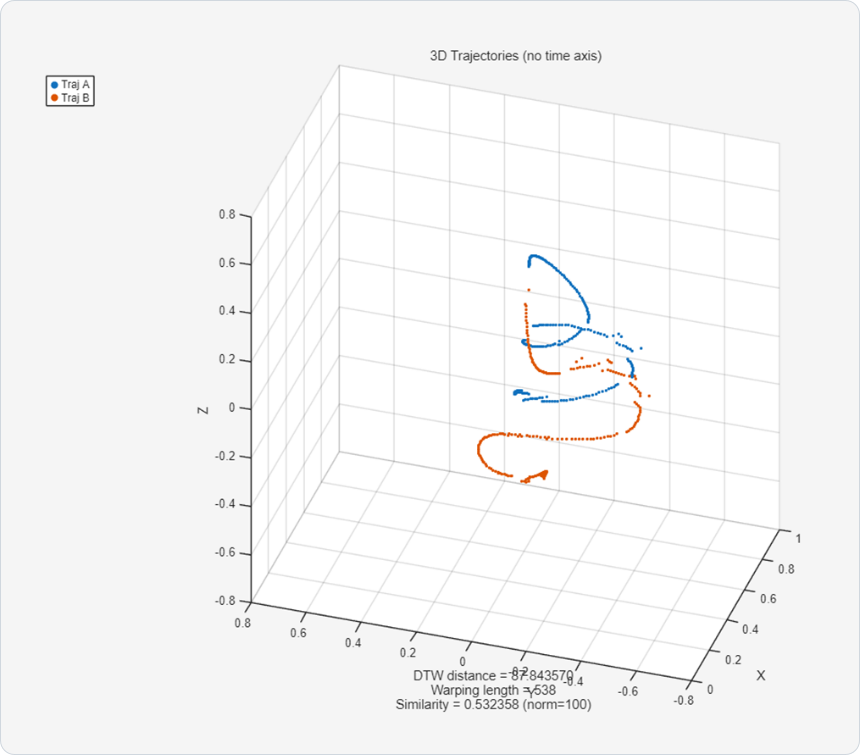
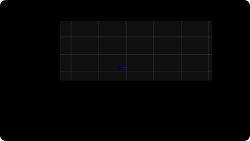
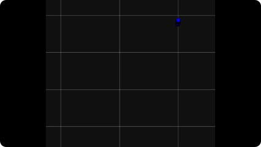
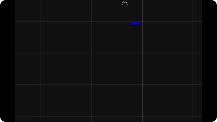
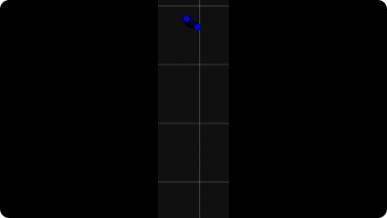
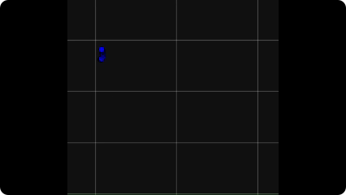
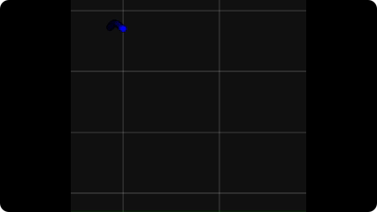
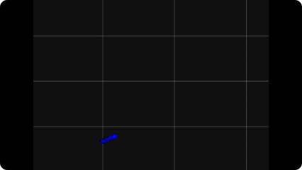
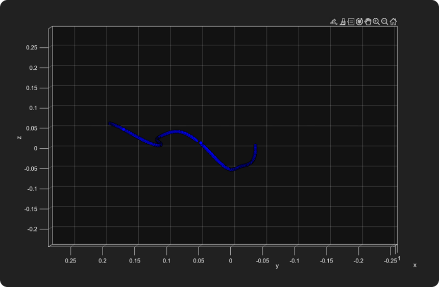

[← README](../README.md) · [이전](08_background_processing.md) · [다음](10_dtw_similarity.md)

# 2.9 3D 궤적 인식 및 검증

2.1~2.8까지의 과정을 통해 Sub-bin 수준의 거리 추정 및 수평각도, 수직각도 추정을 성공해냈다. 이 세가지 정보($R, \theta, \varphi$)를 바탕으로 각각의 Frame에 대칭되는 점을 x, y, z 좌표에 나타낼 수 있다. 본 연구에서 사용한 좌표축은 다음과 같다.

*(x, y, z) 좌표축*

X 축은 레이더로부터의 거리(+값만 존재), Y 축은 수평(레이더에서 바라본 기준, phi는 오른쪽이 +, Y축은 왼쪽이 +이다), Z 축은 수직(레이더에서 바라본 기준, theta와 Z 축 모두 위쪽이 +)이다. 다음의 식을 통해 좌표축 변환을 수행했다. 또한, THE SHIN LAB의 모든 글자를 전부 레이더 앞에서 직접 그리고 그 샘플을 추출하여 분석해봄으로써 3D 궤적을 잘 얻어내는지 검증했다. 그 결과는 다음과 같다.

| T | H | E |
|:-:|:-:|:-:|
|  |  |  |

| S | H | I | N |
|:-:|:-:|:-:|:-:|
|  |  |  |  |

| L | A | B |
|:-:|:-:|:-:|
|  |  |  |

*THE SHIN LAB을 한 글자씩 손으로 그려 얻은 3D궤적*

---

**Tracking 검증**

Doppler Interpolation을 위해 도입한 초기위치(init_pos)의 개념은 샘플을 측정하기 시작할 때의 위치를 강제로 고정하게끔 만들었다. 이를 측정조건의 제약이라고도 볼 수 있지만 오히려 한 물체를 추적할 수 있다는 이점을 가져왔다. 이를 위해 2D-MUSIC을 적용할 때, 처음 각도를 추정할 때는 특정 Range bin에서 전 범위의 각도를 탐색했으나, 한 번 인식한 뒤에는 직전 추정 각도 기준 ±4° 범위만 sweep하여 peak를 찾아내는 방식을 적용함으로써, 시간복잡도를 개선함과 동시에 한 번 인식한 물체를 추적(Tracking)할 수 있게 되었다.

*Tracking 검증을 하기 위한 샘플 측정*

위의 그림과 같이 앞 손은 고정된 시작위치에, 뒷 손은 3.87cm(Range bin)이상 차이나게 두고, 서로 반대방향으로 움직이는 샘플을 분석하였다.

*Tracking 검증용 샘플에 대한 3D 궤적(왼쪽으로 이동)*

추적하는 물체에 해당하는 앞 손을 왼손으로 움직였기에 궤적 역시 왼쪽으로 움직였고 이를 통해 한 물체를 추적할 수 있음을 알 수 있다. 또한, 배경파일을 측정할 당시에는 사람이 앉아있지 않았는데, 실제 샘플 측정할 당시에는 사람이 레이더 측정범위 내에 존재하게 된다. 이를 효과적으로 무시하고 시작위치의 물체만 추적할 수 있기에 배경이 변화하는 것에도 성능이 저하되지 않음을 알 수 있다.

---

[← README](../README.md) · [이전](08_background_processing.md) · [다음](10_dtw_similarity.md)
