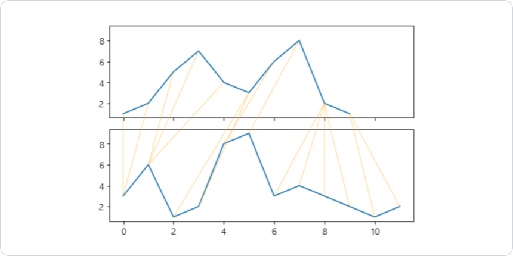
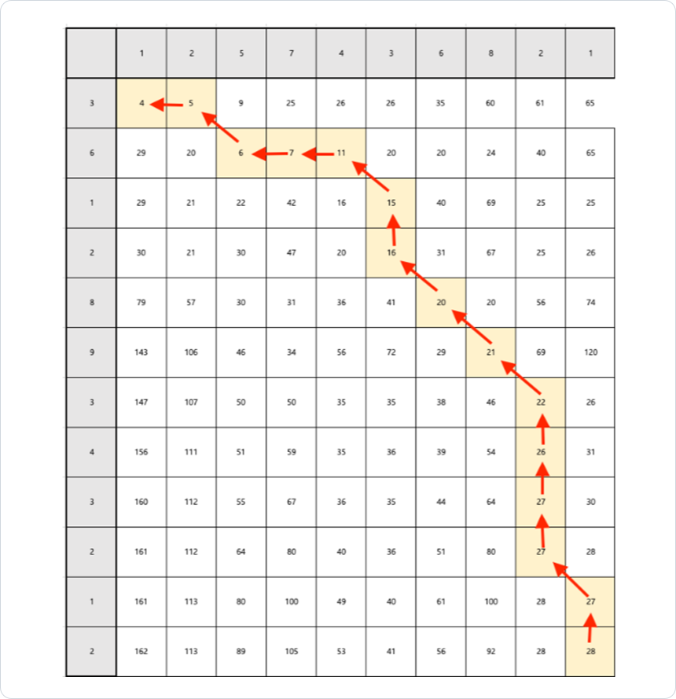
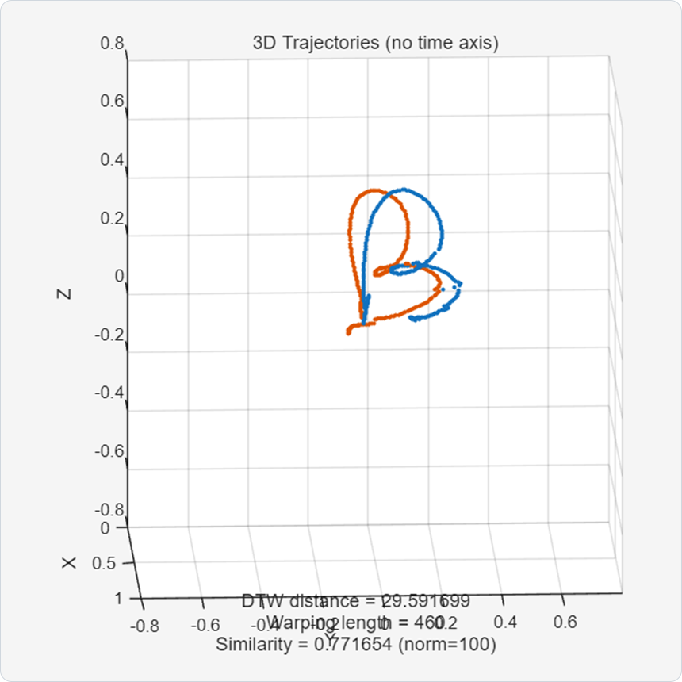
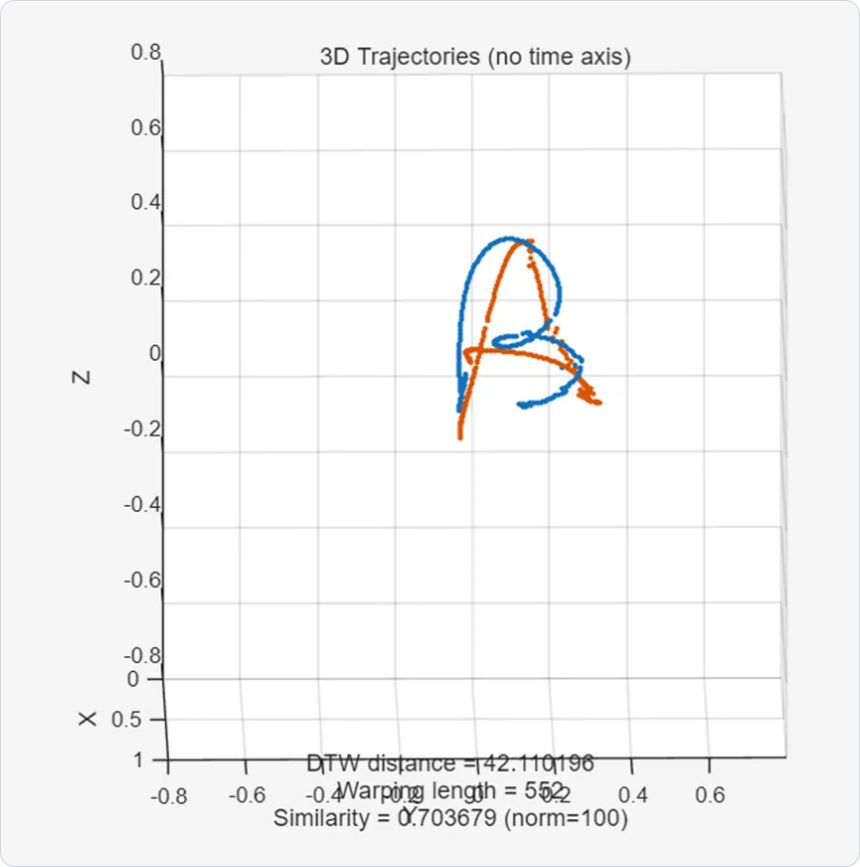
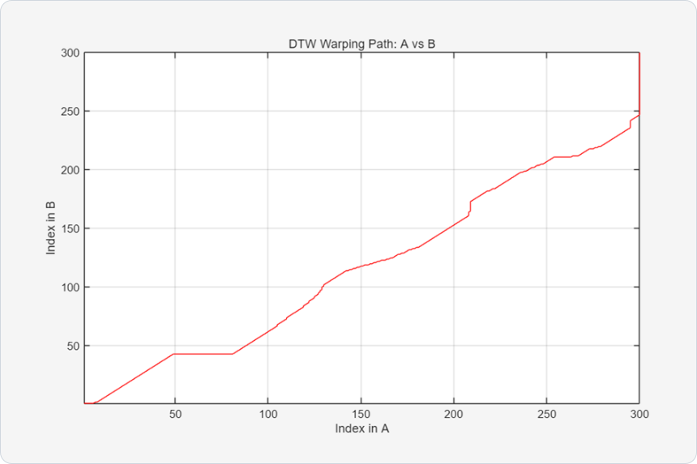
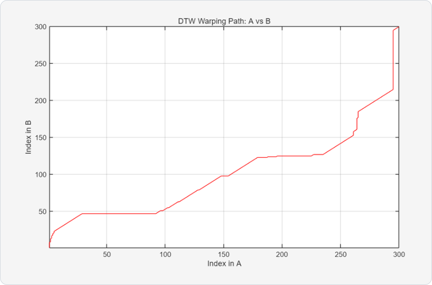

[← README](../README.md) · [이전](09_3d_trajectory.md)

# 2.10 DTW(Dynamic Time Warping) 알고리즘을 이용한 유사도 비교

2.9에서 얻어낸 3D 궤적을 Frame별 (x, y, z)정보만 담겨있는 mat파일로 저장하여 DTW(Dynamic Time Warping) 알고리즘을 이용해 두 궤적의 유사도를 구해 본인확인을 하는데 사용할 수 있다. 먼저, DTW 알고리즘은 다음 그림을 통해 이해할 수 있다.

*DTW Matrix*

두 궤적의 Frame index를 각각 x축과 y축에 나열하여 그 index에 해당하는 두 궤적의 위치에 대한 유클리다안 거리(Euclidean Distance)로 행렬을 채울 수 있다. 본 연구에서는 길이가 같은 두 궤적을 비교하기에 정사각형 행렬이 만들어지나, DTW 알고리즘은 길이가 다른 두 궤적에 대해서도 특정 구간을 압축하거나 팽창시켜 대조시켜 비교할 수 있다. 해당 그림에서 빨간색 동그라미가 압축되어 위쪽의 궤적과 대응됨을 알 수 있다. 규칙은 다음과 같다. 위, 왼쪽, 대각선 중에 가장 거리 값이 작은 칸을 탐색하며 이동하여 시작점까지 이동한다. 이때, 거리 값이 같은 경우는 대각선으로 이동한다. DTW 행렬에서 빨간색 동그라미 부분은 연속적으로 위로 이동한 부분인데, 이 부분은 궤적에서와 동일하게 압축된 부분임을 알 수  있다.
지나온 경로의 모든 거리 값을 합한 것이 DTW Distance이고, 이 값이 높을수록 유사도가 낮게 식을 설정하였으며 Norm이 낮을수록 유사도가 민감하게 반응한다. 식은 다음과 같다.

이 알고리즘을 바탕으로 실제로 얻어낸 두 궤적을 비교해보았다.

*B1.mat와 B2.mat를 DTW.m을 통해 비교*

*B1.mat와 A1.mat를 DTW.m을 통해 비교*

두 궤적의 유사도는 각각 77%와 70%로 올바른 결과를 얻었음을 알 수 있다.
또한, DTW 알고리즘은 정지시점이 다른 같은 궤적에 대해서도 워핑 경로가 달라지기 때문에 유사도가 달라지고, 이를 통해 사용자의 미세한 습관을 잡아내 본인확인의 정밀성을 높일 수 있어 이 알고리즘을 본인확인에 사용하게 되었다. 고전적인 신호 비교방법은 정지시점이나 정밀한 궤적에 대해서 비교하지 못하기 때문에 차용하지 않았다.

다음은 두 샘플에 대한 Warping Path비교이다.

*B1과 B2에 대한 Warping Path*

*B1과 A1에 대한 Warping Path*

---

[← README](../README.md) · [이전](09_3d_trajectory.md)
